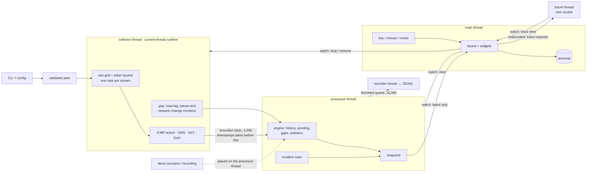

# pathwatch — architecture

pathwatch is a Cargo workspace of three crates:

| Crate | Role |
|---|---|
| `crates/pathwatch-core` | Measurement: probes, scheduling, history, statistics, incidents, recording, replay. It has no terminal dependencies. |
| `crates/pathwatch-tui` | The dashboard: draws snapshots published by the core and turns key presses into a view specification. |
| `crates/pathwatch` | The command-line program: parses arguments, starts the threads, wires the channels, handles signals and exit codes. |

One rule shapes everything else: **the renderer can never influence a measurement.** Sockets, timers and timestamps live on a thread that never waits for statistics, the disk or the terminal, and a snapshot is a pure function of what was observed, so drawing more or less often cannot change a number.

This document describes the architecture as built and the reasoning behind its main decisions. It began as a design written before any code existed; where the code ended up somewhere else, a note marked **Differs from the original design** says so. What the program measures and how each number is defined is in [design.md](design.md). What is not built, or built and not yet verified on real hosts, is in [ROADMAP.md](../../ROADMAP.md).

Section numbers are stable: source-code comments cite §3.2, §5, §6 and §7.

---

## 1. Decision

Rust, with Ratatui 0.30 (Crossterm 0.29 backend) and Tokio 1.x. Networking is written directly on `socket2` and `libc`. `hickory-proto` is used as a DNS codec only. DoT and DoH run over `tokio-rustls` and `hyper` on sockets the program dials itself.

---

## 2. Why Rust

Performance did not decide it: at four providers and a few probes a second, any mainstream stack is fast enough. No benchmarks were run. These points did:

1. **Socket-level control is the core of the product.** Truthful ICMP outcomes on Linux need `IP_RECVERR` and the socket error queue; truthful TTLs and receive times need control messages. In Rust that is `socket2` plus a few `libc` calls. The maintained ping crates do not do this (§3.2).
2. **Timing boundaries stay in the program's hands.** Dialling a TCP socket, handing it to `tokio-rustls`, then to `hyper`'s connection-level HTTP/2 API gives separate connect, handshake and request timings and exact knowledge of connection reuse (§3.4).
3. **Route tracing can reuse the ICMP engine**, unprivileged, on both systems (§3.3).
4. **Deterministic tests.** Tokio's paused clock auto-advances timers on a current-thread runtime, which is exactly the shape of the collector (§4.2).

The credible alternative was Go with Bubble Tea: `net/http/httptrace` gives DoH phase timings with less code and packaging is simpler, but there is no clearly maintained traceroute library and control-message access is less direct. Python with Textual was not a candidate: its convenient libraries hide the phases this program must expose, and probe timestamps would share an interpreter with rendering.

What Rust costs is listed in §8: the chart, timeline and histogram are custom widgets, colour downgrade is application code, and the ICMP engine and DoT/DoH clients are hand-written.

---

## 3. Dependencies and backends

### 3.1 Dependency set

Kept deliberately small. Versions are the ones in `Cargo.lock`; the workspace manifest (`Cargo.toml`) holds the requirements. The minimum supported Rust version is 1.88 (`rust-version` in the workspace manifest).

| Crate | Locked | Used by | Responsibility | Constraint to respect |
|---|---|---|---|---|
| `tokio` | 1.54.1 | all | runtimes, timers, `AsyncFd`, channels, signals | never use `Interval`'s default `Burst` behaviour (§4.3) |
| `tokio-util` | 0.7.20 | core, cli | `CancellationToken` | — |
| `socket2` (feature `all`) | 0.6.5 | core | ICMP datagram, UDP and TCP sockets; TTL | has no setter for `IP_RECVERR` or IPv4 `IP_RECVTTL`; those go through `libc` |
| `libc` | 0.2.191 | all | the calls `socket2` lacks (error queue, control messages, suspend-aware clocks) and a few host queries | every `unsafe` block carries a `SAFETY` comment (§4.1) |
| `hickory-proto` (no default features) | 0.26.3 | core | DNS message build and parse only | codec only: no hickory transport, client or resolver on the measurement path |
| `rustls`, `tokio-rustls` | 0.23.46 / 0.26.6 | core | TLS for DoT and DoH over a socket the program dialled; server name supplied separately from the address | the default crypto provider (`aws-lc-rs`) needs a C compiler at build time |
| `rustls-platform-verifier` | 0.7.1 | core | certificate verification against the OS trust store | verification runs inside the handshake and is part of the handshake time (§3.4) |
| `hyper`, `hyper-util`, `http-body-util`, `http`, `bytes` | 1.12.0 / 0.1.21 / 0.1.5 / 1.5.0 / 1.12.2 | core | HTTP/2 for DoH through the connection-level API (`client::conn::http2`) | the program owns the connection lifecycle; there is no pooling layer |
| `getrandom` | 0.3.4 | core | the per-session nonce in echo payloads; the echo identifier on macOS | — |
| `serde`, `serde_json`, `toml` | 1.0.229 / 1.0.154 / 1.2.2 | core, cli | configuration and JSONL | — |
| `thiserror` | 2.0.21 | core | typed errors | — |
| `jiff` | 1.0.1 | core | UTC wall-clock timestamps (RFC 3339) | wall time is never used to compute a duration |
| `ratatui` | 0.30.2 | tui, cli | layout, buffer, terminal setup and restore | pre-1.0: expect breaking changes |
| `crossterm` (feature `event-stream`) | 0.29.0 | tui | asynchronous terminal events | exactly one Crossterm version in the tree; CI checks it |
| `futures-util` (no default features) | 0.3.34 | tui | `StreamExt` for the event stream | — |
| `clap` (feature `derive`) | 4.6.9 | cli | command-line parsing; the manual page is generated from the same definitions | — |
| `etcetera` | 0.11.0 | cli | XDG paths on macOS as well as Linux | — |
| *dev:* `rcgen` | 0.14.10 | core tests | certificates for local DoT/DoH test servers | — |

Deliberately not used: `surge-ping` (§3.2), `reqwest` (cannot separate connect, TLS and request, or report reuse), `hickory-net` / `hickory-resolver` on the measurement path (no phase timing or peer address), `hdrhistogram` (exact percentiles from raw samples are simpler and sufficient), `trippy-core` (§3.3).

Everything in the tree is permissively licensed. The allow-list is `deny.toml`, checked by `cargo deny` in CI. The project itself is `MIT OR Apache-2.0`.

> **Differs from the original design:** the design listed more crates than the code uses. None of these is a direct dependency:
>
> | Planned | What the code does instead |
> |---|---|
> | `netdev`, `netwatcher` (interface and gateway snapshot, change events) | `netwatch.rs` polls every 2 s: it asks the kernel which source address it would use and compares. The gateway is read from `/proc/net/route` and `/proc/net/ipv6_route` on Linux and, on macOS, by running `/sbin/route -n get default` (`localnet.rs`) — by absolute path, with fixed arguments and no shell. That is the only subprocess the program ever starts. |
> | `system-configuration`, `resolv-conf` | `/etc/resolv.conf` is parsed by hand (`localnet.rs`) |
> | `tracing`, `tracing-subscriber`, `tracing-appender` | there is no logging. What a session has to say is in its events and, when recording, in the recording. The `[logging]` configuration table is accepted and has no effect. |
> | `anstyle-query` | `theme.rs` reads `NO_COLOR`, `COLORTERM` and `TERM` itself |
> | `unicode-width` | not a direct dependency; the cell writer in `widgets.rs` advances one cell per character |
> | `signal-hook` | suspend is `libc::raise(SIGTSTP)` in `app.rs`; `SIGTERM`, `SIGHUP` and `SIGINT` come through Tokio's signal support |
> | `insta`; `termlens` or `portable-pty` + `vt100` | golden files compared by the tests' own code (`tests/golden/`); a pseudo-terminal harness written on `libc::openpty` in `crates/pathwatch/tests/terminal.rs` |
> | `trippy-core` | evaluated and dropped (§3.3) |

### 3.2 ICMP: library or hand-written

The measurement semantics ([design.md §4](design.md#4-measurement-semantics)) set the requirements. At the time of the decision the maintained library, `surge-ping` 0.9.1, met only part of them:

| Requirement | `surge-ping` 0.9.1 | Hand-written on `socket2` + `AsyncFd` + `libc` |
|---|---|---|
| Unprivileged datagram sockets, IPv4 + IPv6 | yes (tries datagram, falls back to raw) | yes |
| Send timestamp immediately **before** the send call | no — taken after the call returns | yes |
| Match on payload, not only identifier and sequence | no | yes |
| Report duplicates | no — later replies are discarded | yes |
| Distinguish timeout from ICMP unreachable on Linux unprivileged sockets | no — no error-queue handling, so errors surface as timeouts | yes (`IP_RECVERR` + `MSG_ERRQUEUE`) |
| TTL of the reply on Linux unprivileged sockets | no | yes (`IP_RECVTTL` control message) |
| Late replies annotated on finalised probes | no | yes |
| One shared socket and receiver per family | yes | yes |

**Decision:** a hand-written ICMP engine. It is four files, about 1,500 lines including tests:

- `platform/icmp_sock.rs` — the socket, its options, `recvmsg` and control-message parsing;
- `probe/icmp_packet.rs` — echo encoding and decoding for both families;
- `probe/icmp_core.rs` — reply matching as a pure state machine with no sockets, clocks or async, so deadline edges, late replies, duplicates and reordering are exactly testable;
- `probe/icmp.rs` — one actor per address family owning the socket, the pending table and the deadline queue.

The two systems deliver different shapes on the same kind of socket (`SOCK_DGRAM` with `IPPROTO_ICMP` or `IPPROTO_ICMPV6`), and the engine handles both explicitly. This was checked against kernel and XNU source:

| | Linux datagram ICMP | macOS datagram ICMP |
|---|---|---|
| Echo identifier | rewritten by the kernel to the socket's port; replies are demultiplexed to the socket by it | preserved; **not** used by the kernel for filtering |
| What `recv` returns | Echo Reply only, from the ICMP header onward, no IP header | every inbound ICMP message of the family, for all processes; IPv4 with its IP header |
| ICMP errors | only via the error queue, when `IP_RECVERR` is set | delivered on the same socket if it is unconnected |
| Reply TTL | `IP_TTL` control message (`IP_RECVTTL`); `IPV6_HOPLIMIT` for IPv6 | from the delivered IP header |
| Consequence | read TTL from control messages; drain the error queue | parse the IP header; filter strictly by source, magic, nonce and sequence; count the rest as `unmatched` |

Every echo request carries a token in its payload — a magic value, a per-session nonce, the stream index and the full 64-bit sequence — so replies are matched on payload, not on the 16-bit ICMP sequence, which wraps every 18 hours at 1 Hz.

Because an open ICMP socket on macOS is handed every echo reply arriving at the host, the collector opens one per family only when a stream of that family first needs it.

### 3.3 Route tracing backend

| Option | Unprivileged? | Fit | Cost |
|---|---|---|---|
| **A. Own ICMP tracer on the measurement engine** — set the TTL on a dedicated trace socket, read Time Exceeded from the same socket (macOS) or the error queue (Linux) | macOS: yes. Linux: yes where `ping_group_range` allows | same timestamps, cancellation and budget enforcement as everything else; ICMP only, classic strategy only | a few hundred lines on existing code; Time Exceeded is matched on what the router quotes back — destination, identifier, 16-bit sequence, and the payload token only when the quote is long enough to include it |
| **B. `trippy-core` 0.13.0** | macOS: yes. **Linux: no — needs `CAP_NET_RAW`, root or setuid** | ICMP/UDP/TCP, Paris and Dublin strategies when privileged | API explicitly "not stable"; synchronous, on its own thread; no way to stop a running trace; wall-clock probe timestamps |
| **C. Subprocess** (`trip --mode json`, `mtr --json`) | as B for `trip`; `mtr` varies by build | none of the program's schema or timing | no documented output stability |

**Decision:** A is the only backend (`trace.rs`). B was evaluated and dropped: it cannot stop a running trace, does not pace its probes, and on Linux traces nothing without `CAP_NET_RAW`. C was never planned.

A trace runs only when asked, on a socket of its own, so the measurement sockets never share a TTL with it, and within a stated budget (by default TTL 1 to 30, 10 rounds, at most 300 probes and 30 a second). Nothing it measures feeds the latency series.

### 3.4 What each layer can and cannot time

All durations come from one monotonic clock that does not advance while the host is suspended (`clock.rs`; Tokio's clock, which follows `std::time::Instant`). Wall-clock UTC is recorded beside it for display and is never used to compute a duration. Definitions are in [design.md §4.1](design.md#41-clocks-and-timestamp-points).

| Layer | Where the measurement starts → ends | Not separable |
|---|---|---|
| ICMP echo | user-space timestamp immediately before `send` → the **kernel's receive stamp** for the reply (`SO_TIMESTAMPNS` on Linux, `SO_TIMESTAMP_MONOTONIC` on macOS). The wait between the kernel receiving the reply and the process reading it is measured and recorded separately (`recv_delay_us`). Without a kernel stamp the round trip ends at the process's read | kernel send queueing, NIC time |
| DNS over UDP | user-space timestamp before `send` → after `recv` | kernel queueing, NIC time, receive-side scheduling delay (flagged by the loop-lag monitor, not removed) |
| TCP connect | connect future started → socket writable | SYN retransmissions (a ~1 s connect is probably a retransmit, but that is inference) |
| TLS handshake | `TlsConnector::connect` started → resolved | network round trips, server compute and **local certificate verification**, which runs inside the handshake |
| DoT query (reused connection) | first byte of the length-prefixed query written → last byte of the response read | server processing vs network |
| DoH request (reused connection) | request future started → response headers (`ttfb`) → body complete | HTTP/2 frame scheduling; server processing vs network |
| HTTP/2 connection setup | client preface written | the server's SETTINGS exchange is not a clean phase; the first request on a fresh connection absorbs it and is flagged `fresh` |
| Connection facts | reuse, age, ALPN, TLS version, full or resumed handshake, peer address | — (the program owns the connection objects) |
| Bootstrap resolution through the OS | call start → return, recorded as a duration only | which upstream answered, TTLs, cache hits |

A loop-lag monitor on the collector wakes every 50 ms and records how late it woke. When the last wake-up was more than 5 ms late, observations whose timestamps were taken in user space are flagged `timing_suspect`.

---

## 4. Modules and concurrency

### 4.1 Modules and data flow

**`crates/pathwatch-core/src`**

| Module | Purpose |
|---|---|
| `capability` | Host capability detection for `doctor`: opens sockets and reads system state; sends nothing and changes nothing |
| `clock` | The `Clock` trait (session-monotonic time, wall time, suspended time), the real and manual clocks, and the gap detector |
| `collector` | Owns every socket and timer: one task per stream, the monitors, configuration reloads |
| `config` | Parsing, layering, validation, and derivation of the stream plan |
| `correlate` | Groups incidents that open together on comparable streams; a pure function of incidents and statistics |
| `discovery` | Hostname bootstrap and destination epochs, off the timing path |
| `engine` | The observation processor's state: bounded history per stream, pending probes, the gap timeline, window statistics |
| `glossary` | Every word and number the program shows, with its meaning; feeds the dashboard help, `pathwatch glossary` and the documentation |
| `incident` | Incident rules for one stream, with hysteresis and cooldown |
| `localnet` | The default gateway and the system's resolvers, read from system state; reverse lookups for trace hops |
| `model` | Identity and record types; their serialised field names are the JSONL schema (§6) |
| `netwatch` | Source context (local address, interface, gateway) and noticing when it changes |
| `platform/mod` | The suspend-aware clock pair |
| `platform/icmp_sock` | Unprivileged ICMP datagram sockets (§3.2) |
| `probe/mod` | What the probe adapters share: stream context, counters, the outbox to the processor |
| `probe/icmp`, `icmp_core`, `icmp_packet` | The ICMP echo engine (§3.2) |
| `probe/dns` | Explicit DNS transactions over UDP and over TCP |
| `probe/doh` | DNS over HTTPS **and** DNS over TLS, with connection phases timed separately; the two share everything up to the end of the TLS handshake |
| `processor` | Engine plus incident state: turns collector messages into snapshots |
| `recorder` | Writing a recording, reading one back, and preparing one for replay (§7) |
| `sanitize` | Cleaning untrusted text of control characters and bidirectional overrides |
| `schedule` | The slot grid, phase stagger and token bucket (§4.3) |
| `script` | A deterministic observation source driven by scenario scripts; `demo` and `replay` both play through its `Playback` |
| `snapshot` | Immutable view models; a pure function of processor state, the selected view and a point in time |
| `stats` | Window statistics; a pure function of the samples handed in |
| `testing` | Test support: a scripted ICMP transport and network driven by the pausable Tokio clock. Not used by the production binary |
| `trace` | On-demand ICMP route trace (§3.3) |
| `traffic` | Accounting of what the collector put on the wire |

**`crates/pathwatch-tui/src`**

| Module | Purpose |
|---|---|
| `app` | Interaction state, the keyboard map, the optional mouse, and the event loop |
| `mouse` | Mouse capture: off unless asked for; presses and wheel only |
| `theme` | Colour depth, glyph sets, and the status vocabulary |
| `ui` | Screen composition for the three layouts |
| `widgets` | Drawing primitives: write cells into a buffer from a snapshot |

**`crates/pathwatch/src`**

| Module | Purpose |
|---|---|
| `main` | Entry point: the commands (`run`, `demo`, `sample`, `replay`, `export`, `doctor`, `config`, `glossary`, `man`), exit codes, headless collection |
| `dashboard` | The interactive commands: starts the processor and tracer threads and runs the dashboard |
| `assert` | `sample --assert`: turns what was measured into an exit status |
| `man` | The manual page, generated from the command definitions; `docs/pathwatch.1` is its output |
| `recording` | The recorder thread and its bounded queue |
| `reload` | Reloading the configuration file while a session runs: validated in full first, applied whole or not at all |
| `summary` | The plain-text summary: one row per stream, plus what was not measured and why |

The built-in configuration is `crates/pathwatch-core/src/pathwatch.example.toml`, compiled into the core crate; a user's file and command-line overrides are layered on top of it. `docs/configuration.md` is compiled into the command-line program and printed by `pathwatch config reference`.

**Abstraction points.** There is no common probe trait: each protocol has its own stream function in `collector.rs` built on shared plumbing in `probe/mod.rs`. The traits that exist are the seams tests replace:

| Trait | Defined in | Stands for |
|---|---|---|
| `IcmpIo` | `probe/icmp.rs` | the ICMP socket, for measurement and for route traces; tests use scripted ones from `testing.rs` |
| `NetProbe` | `netwatch.rs` | what the host's network looks like (source address, gateway, resolvers) |
| `Storage`, `Segment` | `recorder.rs` | the filesystem under a recording; tests use one that runs out of space |
| `Clock` | `clock.rs` | monotonic, wall and suspended time; tests use a manual clock on Tokio's paused clock |

**What the compiler enforces, and what it does not.** `pathwatch-core` does not depend on Ratatui or Crossterm, so the renderer cannot own probe timing. The reverse boundary is a convention: `pathwatch-tui` depends on the whole of `pathwatch-core` and imports from `snapshot`, `model`, `stats`, `glossary`, `trace`, `recorder::Status` and `collector::PauseSwitch`. Nothing in the type system stops it opening a socket; it performs no network work because its code does none.

**`unsafe`.** Most of it is in `platform/`, but not all. Outside it, `unsafe` appears in `capability.rs` (group ids, kernel release), `localnet.rs` (`getnameinfo`), `netwatch.rs` (`getifaddrs`), `recorder.rs` (`statvfs`), `probe/icmp.rs` (registering the socket with `AsyncFd`), `pathwatch-tui/src/app.rs` (`raise(SIGTSTP)`) and `pathwatch/src/dashboard.rs` (checking the terminal is still there). Every block has a `SAFETY` comment, and the workspace denies `unsafe_op_in_unsafe_fn`.

> **Differs from the original design:** the design had one directory per concern, probe adapters behind one trait, `platform/{linux,macos}.rs` holding all `libc` and `unsafe`, and a TUI crate that could see only `snapshot`. The code is flatter, has no probe trait, uses `libc` wherever a host query is needed, and lets the TUI import a handful of core types directly rather than mirroring them into `snapshot`.



### 4.2 Threads and tasks

| Thread | Runs | Why separate |
|---|---|---|
| **Collector** | a current-thread Tokio runtime: every stream's slot loop, all measurement sockets, the ICMP actors, deadlines, the gap, loop-lag, pause and network-change monitors | nothing here blocks on the terminal or on statistics, so timestamps are taken promptly; it is also the runtime flavour the paused-clock tests require |
| **Processor** | ingests collector messages, keeps history, computes statistics and incidents, builds snapshots, hands a copy of each record to the recorder, applies reload requests | recomputing a 24-hour percentile must not delay a receive timestamp |
| **Main (UI)** | a current-thread runtime: terminal events through Crossterm's `EventStream`, layout, drawing, `SIGTERM` and `SIGHUP` | a slow terminal or SSH link can block a write; that must stall only drawing |
| **Recorder** | JSONL serialisation and file I/O, one batch and one flush per wake-up | disk latency stays off every other path |
| **Tracer** | a current-thread runtime serving route-trace requests, one trace at a time, each on its own socket | a trace must never touch a measurement socket or its TTL |
| Tokio blocking pool | the OS resolver (`tokio::net::lookup_host`), reading the routing table, reverse lookups for trace hops | synchronous calls |

The recorder thread exists only when recording; the tracer only in a live dashboard session. Headless `sample` has no UI thread: the main thread ingests messages and offers them to the recorder.

Each stream is its own task on the collector. A slow or dead target occupies only its own pending entries: it cannot delay another stream's send, and no stream waits on another's reply. ICMP streams hand their requests to the family's actor and move on.

### 4.3 Scheduling

- **Slot grid** (`schedule.rs`). Stream *i* sends at `t0 + phase_i + k × interval`. Phases spread streams that share an interval evenly across it, in configuration order, so runs are reproducible and probes do not leave in synchronised bursts.
- **Missed ticks.** A stream sleeps until its next slot and, on waking, computes which slot index "now" belongs to. Slots that were passed over are recorded explicitly as `skipped` with category `late_timer`. If the wake-up is more than 2 s late, nothing is recorded per slot: the gap monitor records an observation gap instead ([design.md §4.5](design.md#45-observation-gaps)). This is the behaviour Tokio documents for `MissedTickBehavior::Skip`, with the accounting that `Interval` does not provide.
- **Why not the alternatives.** `Burst`, the default for `tokio::time::interval`, ticks as fast as possible until caught up — exactly the catch-up burst of probes this design forbids. `Delay` re-bases the schedule on the late tick, so the phase stagger would drift and streams could align.
- **After suspend.** Tokio timers follow a clock that does not advance during system sleep, so no backlog of timers exists on resume. The gap detector compares that clock with one that does count suspended time (§5) and supplies the missing knowledge that time passed.
- **Global limits.** A token bucket (25 transactions a second, burst 40, by default) sits in front of every send; a refused slot is `skipped` with category `rate_limit`. Each ICMP actor's request queue holds `limits.max_in_flight` requests (128 by default); a slot that finds it full is `skipped` with category `backpressure`.
- **No overlap.** A stream on UDP, TCP, DoT or DoH runs one transaction at a time, because its task awaits the result before taking the next slot, and validation refuses an interval that is not longer than the deadline. ICMP may have several probes pending because its deadline (2 s) exceeds its interval (1 s). The `in_flight` skip category exists in the schema; nothing emits it.
- **Deadlines** are absolute monotonic instants. ICMP deadlines are kept in one queue per actor, not one timer per probe.

### 4.4 History and memory bounds

| Store | Per stream | Bound | Size |
|---|---|---|---|
| Compact samples (`stats::Sample`) | sequence, time, outcome, RTT, epoch, eligibility — **32 bytes** each | `history.samples`, 24 h by default | about 2.8 MB per 1 Hz stream; about 0.55 MB per 5 s stream |
| Kept records (`engine::Kept`) | what the list views read back from an observation; at most 160 bytes each before what it points to (a test holds the limit) | `history.records`, 1 h by default | — |
| Events | all streams | 10,000 | — |
| Trace | the latest trace view | bounded by the trace budget | negligible |

Full observations are not kept in memory: a `Kept` record is about a quarter of the size and shares what is the same across records. A recording is written from the full observation and is unaffected. The resident-memory budget and how it is measured are in [verification.md](verification.md).

Statistics for a window are computed from that window's samples and remembered per stream (up to eight windows), keyed by exactly which samples they were computed from, so an unchanged window is not recomputed.

### 4.5 Channels, back-pressure and overload

| Channel | Type and capacity | When full | What the user sees |
|---|---|---|---|
| Observations: collector → processor | bounded `mpsc`, 4,096 | the collector **reserves room for a probe's two messages** (the "sent" notice and the final record) **before sending the probe**; if it cannot, the slot becomes `skipped(backpressure)`. A probe that was sent can therefore always report its result | the skipped slots themselves, and a counter in the session's closing record and the summary, separate from every network rate |
| Records not tied to a probe (events, gaps, skipped slots, late and duplicate annotations) | the same channel, then a local overflow queue of 4,096 | dropped and counted in `dropped_records` | the same instrument-health counters |
| ICMP requests: stream → actor | bounded `mpsc`, `limits.max_in_flight` | `try_send`; the slot becomes `skipped(backpressure)` | as above |
| Snapshot: processor → UI | `watch` (keeps only the latest) | overwritten | nothing; stale frames are never drawn |
| View: UI → processor | `watch` (keeps only the latest); a change also wakes the processor at once | overwritten | — |
| Stop / resume: UI → collector | `watch<bool>` (`PauseSwitch`) | — | — |
| Reload: UI or `SIGHUP` → processor thread → collector | requests are coalesced into one reload; the validated plan goes over a bounded `mpsc` of 4 with `try_send` | the reload is refused with a reason | an event |
| Recorder: processor → recorder | bounded queue, 16,384 records | `try_send`; the record is dropped and counted | the count in the dashboard's recording status and on exit; measurement unaffected |
| Trace requests: UI → tracer | unbounded `mpsc` (one message per key press; a request arriving while a trace runs is ignored) | — | — |
| Trace view: tracer → UI | `watch` | overwritten | — |

**Order of sacrifice under load:** render frames (coalesced by construction), then recording (with counted drops), then measurement slots (as explicit `skipped` records). Nothing is discarded silently, and a collector drop can never be mistaken for network loss because it never enters a network denominator.

**Rendering cadence.** The processor publishes a snapshot on a fixed 100 ms tick (`SNAPSHOT_EVERY` in `dashboard.rs`), or every second while the view is frozen, and at once when the view changes. The UI draws when a new snapshot arrives or an input event does; with reduced motion, new data redraws at most four times a second and keys are still answered at once. Collection cadence depends on none of this.

> **Differs from the original design:** the design had the UI redraw only when the snapshot changed, at up to 15 fps while an animation ran, and sleep otherwise. The code uses the fixed tick and has no animation frame rate. The design's bounded command channel (64) and bounded reverse-lookup queue (64) do not exist: view changes go over the `watch` channel and reverse lookups are spawned on the blocking pool, one per newly seen hop address. The recorder queue is 16,384, not 8,192, and a dropped record is counted but no gap record is written into the recording.

### 4.6 Cancellation, shutdown and errors

- One root `CancellationToken` for the session; each stream has a child token, so a reload that removes or redefines a stream stops only that stream. Each trace has its own token.
- **Shutdown order** (`dashboard.rs`): restore the terminal → cancel the root token → the collector stops scheduling, finalises probes in flight as `cancelled`, writes the session's closing record and drains its outbox → the main thread passes those last records to the recorder → the recorder writes what is queued, flushes and syncs. The original design's overall time limit on shutdown is not built.
- **Terminal restoration** happens first on every exit path — normal quit, signal, error, panic (the panic hook restores before printing) — and covers raw mode, the alternate screen, cursor visibility and mouse capture.
- **Error classes.** A failing probe is data: an observation or an event. A failing stream (a socket cannot be created) is a stream state. A failing recorder stops recording and says why. Only failures of the instrument itself — a thread panic, an unrecoverable terminal error — end the process, with exit code 1 after restoration.

---

## 5. Platform capability matrix

What the operating system permits, kept separate from what pathwatch implements. Which rows have been exercised on real hosts is in [ROADMAP.md](../../ROADMAP.md); what the host must provide, for users, is in [capabilities.md](../capabilities.md).

| Capability | Linux — OS | macOS — OS | pathwatch |
|---|---|---|---|
| Unprivileged ICMPv4 echo | allowed if one of the process's groups is within `net.ipv4.ping_group_range`; the kernel default is off (`1 0`); kernel ≥ 3.0 | allowed by default (datagram ICMP socket) | yes |
| Unprivileged ICMPv6 echo | the same sysctl governs it; kernel ≥ 3.11 | allowed by default | yes |
| Raw ICMP | needs `CAP_NET_RAW` in the owning user namespace, or root | needs root | not built; never requested or escalated to |
| ICMP errors visible on the unprivileged socket | yes, via `IP_RECVERR` and the error queue | yes, on an unconnected socket | yes |
| Reply TTL on the unprivileged socket | yes, via the `IP_RECVTTL` control message | yes, from the delivered IP header | yes |
| Kernel receive timestamps | available on ping sockets (`SO_TIMESTAMPNS`, realtime clock) | available (`SO_TIMESTAMP_MONOTONIC`) | in use for ICMP: the round trip ends at the kernel stamp (§3.4) |
| Unprivileged route trace, ICMP probes | yes where ping sockets are enabled (`IP_TTL` + error queue) | yes (`IP_TTL`; Time Exceeded arrives on the socket) | yes (§3.3) |
| Unprivileged route trace, UDP probes | yes by default (UDP socket + error queue) | yes (errors read from a datagram ICMP socket) | not built |
| Flow-controlled traces (Paris/Dublin), TCP SYN | needs `CAP_NET_RAW` or root | needs root | not built |
| Bind to a source address or interface | unprivileged `bind()`; `SO_BINDTODEVICE` unprivileged on kernel ≥ 5.7 for a socket not already bound | unprivileged `bind()`; `IP_BOUND_IF` / `IPV6_BOUND_IF`, no privilege check | not built; only empty `[source]` values are accepted, and the OS routing table decides |
| Suspend-aware clock pair | `CLOCK_MONOTONIC` (excludes suspend) vs `CLOCK_BOOTTIME` (includes) | `CLOCK_UPTIME_RAW` (excludes) vs `CLOCK_MONOTONIC_RAW` (includes) | yes, for gap detection |
| DNS over UDP/TCP/TLS/HTTPS | no privilege | no privilege | yes |

**Where Linux unprivileged ICMP is on by default.** Distributions shipping systemd's default sysctl file (systemd ≥ 243) — Fedora 31+, Arch, and Debian 13 through its `linux-sysctl-defaults` package — and Docker ≥ 20.10 containers. Ubuntu does not set it, according to its bug tracker, which restored a capability on `ping` instead. Other hosts vary. Sources are in [references.md](references.md).

**What the program does about it.** `pathwatch doctor` reports, per family, whether the datagram ICMP socket could be opened, and with it the current `ping_group_range`, the process's group ids, the kernel release, whether the kernel rewrites the echo identifier, whether ICMP errors come through the error queue, and which clock pair is in use. Where ICMP is refused it prints the remedy the operating system documents — the one-line sysctl that systemd's defaults use, `net.ipv4.ping_group_range = 0 2147483647`, in a file under `/etc/sysctl.d/`, or inside a container with a narrow group mapping a range covering only the process's own group — for an administrator to apply or not. It never applies it. ICMP streams then show as unsupported, never as loss, and DNS measurement proceeds.

Privilege escalation is never part of normal operation.

---

## 6. Observation schema

Schema version 1 (`SCHEMA_VERSION` in `model.rs`). One JSON object per line. Every line carries `schema` (integer) and `kind`; the remaining fields are those of the record. The serialised field names in `model.rs` are the schema.

**Record kinds**

| `kind` | One per | Main fields |
|---|---|---|
| `segment` | recording segment, as its first line | `session`, `segment`, `utc`, `app`, `version`, `os`, `arch`, `redacted`, `providers[]`, `config` (the effective configuration as TOML, secrets masked) |
| `session` | session start and end | `session`, `state` (`start`, `end`), `utc`, `app`, `version`, `os`, `arch`; on start `streams[]` (id, provider, target, protocol, family, configured, interval, deadline, state, reason); on end `counters` and `traffic[]` |
| `config` | configuration reload that was applied | `session`, `rev`, `at_ns`, `utc`, `streams[]`, `providers[]`, `summary` |
| `observation` | finalised slot (see below) | |
| `late_reply` | reply that arrived after its probe was finalised as a timeout | `session`, `stream`, `seq`, `at_ns`, `late_rtt_us` |
| `duplicate` | second reply to a probe that already succeeded | `session`, `stream`, `seq`, `at_ns` |
| `gap` | interval in which the instrument was not observing | `session`, `cause` (`suspend`, `stopped`, `process_stopped`, `network_change`, `collector_stall`), `start_ns`, `end_ns`, `duration_ms`, `end_utc` |
| `event` | thing worth saying once | `session`, `at_ns`, `utc`, `event` (a name), `stream` (optional), `detail` |
| `resolution` | bootstrap lookup | `session`, `at_ns`, `provider`, `target`, `name`, `resolver`, `duration_us`, `addresses[]`, `error` |
| `connection` | DoT/DoH connection opening, failing or closing | `session`, `at_ns`, `stream`, `conn`, `state` (`opened`, `failed`, `closed`), `peer`, `phase`, `alpn`, `tls`, `resumed`, `reason` |

A late or duplicate reply never changes the outcome of the observation it refers to.

**The `observation` record**

| Group | Fields |
|---|---|
| Identity | `session`, `config_rev`, `provider`, `target`, `stream` (`provider/target/protocol/family`), `seq` (64-bit), `transaction` (links attempts, such as a TCP retry after a truncated UDP answer), `attempt` |
| Measurement | `protocol` (`icmp`, `dns-udp`, `dns-tcp`, `dot`, `doh`), `family` (`4`, `6`), `configured` (the target as written, secrets redacted), `dest_ip`, `dest_port`, `epoch` |
| Source context | `src.ctx` (number of the source context in force), `src.if`, `src.ip` |
| Time | `sched_ns`, `sent_ns`, `recv_ns` (monotonic nanoseconds since session start — comparable only within a session), `sent_utc` (RFC 3339), `deadline_ms`, `sched_lag_us` |
| Result | `outcome` (`success`, `timeout`, `unreachable`, `service_error`, `protocol_error`, `local_error`, `skipped`, `cancelled`; see [design.md §4.3](design.md#43-probe-outcomes)), `error.category`, `error.code`, `error.detail` (cleaned), `rtt_us` (absent when there is none — never 0, never the deadline), `flags[]` (`timing_suspect`, `after_reconnect`, `truncated`, `fresh`) |
| Receive delay | `rtt_user_us`, `recv_delay_us` — present when the round trip ended at the kernel's stamp: the round trip as it would read at the process's read, and the difference |
| Phases | `phase.connect_us`, `phase.tls_us`, `phase.ttfb_us`, `phase.request_us` — only the phases that occurred |
| ICMP | `icmp.id`, `icmp.seq16`, `icmp.reply_ttl`, `icmp.type`, `icmp.code`, `icmp.payload` (bytes) |
| DNS | `dns.qname`, `dns.qtype`, `dns.id`, `dns.expect`, `dns.rcode`, `dns.tc`, `dns.answers`, `dns.size`, `dns.min_ttl`, `dns.ede[]`, `dns.matched` |
| Connection | `conn.id`, `conn.reused`, `conn.age_ms`, `conn.alpn`, `conn.tls`, `conn.resumed`, `conn.http_status` |
| Backend | `backend.name` (`icmp-dgram`, `dns-udp`, `dns-tcp`, `dot`, `doh-h2`), `backend.version`, `backend.ts_source` (`kernel-rx` or `userspace-monotonic`: which clock ended the round trip) |

Optional fields are omitted when they have no value.

An illustrative record (wrapped here; one line on disk):

```json
{"schema":1,"kind":"observation","session":"19b7a3c5e10-4f2a","config_rev":1,"provider":"cloudflare",
 "target":"resolver-v4","stream":"cloudflare/resolver-v4/icmp/4","seq":6141,"transaction":6141,"attempt":1,
 "protocol":"icmp","family":"4","configured":"1.1.1.1","dest_ip":"1.1.1.1","epoch":1,
 "src":{"ctx":2,"if":"en0","ip":"192.0.2.10"},
 "sched_ns":6141000000000,"sent_ns":6141000212000,"recv_ns":6141012611000,
 "sent_utc":"2026-01-01T12:03:21.412Z","deadline_ms":2000,"sched_lag_us":212,
 "outcome":"success","rtt_us":12399,"rtt_user_us":12440,"recv_delay_us":41,
 "icmp":{"id":41822,"seq16":6141,"reply_ttl":57,"payload":56},
 "backend":{"name":"icmp-dgram","version":"0.1.0","ts_source":"kernel-rx"}}
```

**Versioning as built.** Unknown fields are ignored. A line with an enum value this version does not know, or any other line that does not parse as a record, is skipped with a warning. A line whose `schema` is newer than the program reads is skipped with a warning. All complete, readable lines are used. There is no converter between schema versions, because there is only one version.

> **Differs from the original design:** the design listed `source_context`, `incident`, `trace_probe` and `recorder_gap` as record kinds, and `trace` as a protocol. As built:
> - a source context and each change to it is an `event` (`source_context`, `source_context_changed`), and observations carry its number in `src.ctx`;
> - incidents are not recorded: they are derived again from the observations whenever a recording is replayed, by the same rules;
> - route-trace probes are not recorded at all;
> - recorder drops are counted, not written as records;
> - late and duplicate replies are records of their own (`late_reply`, `duplicate`) rather than flags and a `late_rtt_us` field on the observation;
> - `src.ifindex` and `conn.sni` do not exist; `rtt_user_us`, `recv_delay_us` and the `kernel-rx` timestamp source were added;
> - unknown enum values are not preserved as text: the line is skipped.

---

## 7. Persistence, recording, and replay

**In memory by default.** Nothing is written to disk unless recording is asked for (`--record`, or `[recording] enabled`). A recording that was asked for and cannot be started is an error before anything is sent.

**JSONL before a database.** A recording is an append-only stream of the records in §6, which is what JSONL is. It needs no migration machinery, survives a crash with at most one truncated last line, streams naturally into replay, and works with `jq`, `grep` and `tail -f`. A database would add a dependency and a schema-migration burden to answer queries nobody has asked for. It is deferred until long-range querying is a demonstrated need.

| Topic | As built (`recorder.rs`, `crates/pathwatch/src/recording.rs`) |
|---|---|
| Layout | `<directory>/<session id>/000001.jsonl`, `000002.jsonl`, … |
| Permissions | owner-only, whatever the umask: directories are created `0700` and segment files `0600`. A recording says where the host sits in its network. A segment is never overwritten: creation fails if the file exists |
| Segment header | the first line of every segment is a `segment` record: session, segment number, application version, host OS and architecture, whether profile ids were redacted, the providers, and the effective configuration. Later segments repeat the session's opening record after it, so each segment is self-describing after earlier ones are deleted |
| Rotation | at `rotate_size` (64 MiB by default) or `rotate_age` (24 h), whichever comes first |
| Retention | a cap on the total under the recording directory (`max_total`, 1 GiB by default), enforced at rotation; oldest segments are deleted first, never the one being written. Only the program's own segments are counted or deleted: a regular file named `NNNNNN.jsonl` whose first line is a segment header. Directories reached through a link, files with other names, and `.jsonl` files that are not recordings are left alone |
| Durability | flushed after every batch; `fsync` on rotation by default (`fsync = "rotate"` or `"never"`); the last segment is synced when the session ends |
| Disk full / write error | recording stops and keeps what it can; an event (`recording_stopped`) says why, once; **measurement continues**; recording resumes only on a restart |
| Low disk | free space is checked every 5 s; recording stops below `min_free_disk` (200 MiB by default) |
| Recorder falls behind | records that do not fit the queue (16,384) are dropped and counted; the count is reported on exit |
| Recovery | a truncated final line is skipped with a warning on replay or export; all complete lines are used |
| Redaction | applied **when a recording is written**: every occurrence of a NextDNS profile id in the serialised line — any field, URL or server name — is replaced, so the id is never on disk and an export cannot leak it. On by default (`[redaction] profile_ids`); a recording made without it says so in its header. Local addresses can be removed from an export with `pathwatch export --redact-local` |

> **Differs from the original design:** redaction of recordings was originally to happen at export time. Doing it at write time means the guarantee does not depend on who runs the export, or where.

**Untrusted text.** Names, error strings and anything else that came off the network are cleaned of control characters, escape sequences and bidirectional overrides where they enter the program (`sanitize.rs`). A recording is a file, and a file can come from anywhere, so text read back from one is treated the same way: `recorder.rs` cleans every string, and every key, of a line as it is read. As the last line of defence, the dashboard's cell writer (`put` in `pathwatch-tui/src/widgets.rs`) refuses to place a control character or an override in a cell, whatever the text's source.

**Replay and demo.** `recorder::read` reads a session directory or a single `.jsonl` file (the output of `sample --format jsonl` is a valid recording without a header); `recorder::prepare` lays its records out as timed messages. `script::Playback` then feeds them to a processor of its own against a virtual clock — the same type plays the built-in demo scenarios. Playback runs on the processor thread in place of the live source, with no collector and no network activity, cannot write a recording, and is labelled as a demo or a replay in the header for the whole session. Because statistics and incidents are pure functions of the records, replaying a recording reproduces what the live session showed; how that is tested is in [verification.md](verification.md).

---

## 8. Trade-offs accepted

| Choice | Cost | Mitigation |
|---|---|---|
| Hand-written ICMP engine | `unsafe` control-message code; two receive shapes | matching is a pure state machine tested without sockets; packet parsing is tested against bytes; integration tests run on both systems in CI |
| No interface or gateway library | a 2 s polling delay before a network change is noticed; a subprocess on macOS to read the gateway | the interval between polls is recorded as a short observation gap, and probes in flight are cancelled rather than counted as unanswered; the subprocess runs off the collector thread, by absolute path, with no shell |
| No logging | nothing to read after the fact unless the session was recorded | events are part of the session and of every recording |
| Pre-1.0 UI stack | breaking changes in Ratatui and Crossterm releases | lockfile pins; one Crossterm version, checked in CI; upgrade as its own task |
| Custom chart, timeline and histogram widgets | more UI code than Ratatui's `Chart` | needed anyway for gaps, min–max columns and the cursor; tested against golden screens |
| Own colour downgrade and monochrome | a mapping table to maintain | small, and it makes identity colours deliberate at every depth |
| Several threads instead of one loop | more moving parts | each boundary is a single channel with a stated full-queue behaviour (§4.5) |
| TUI boundary by convention, not by type | nothing but review stops the TUI crate doing network work | the crate has no socket code, and its inputs are snapshots and terminal events |
| `aws-lc-rs` as the TLS crypto provider | a C compiler at build time | acceptable for release builds |
| `trippy-core` not adopted | no UDP, TCP or Paris-style traces | it could not stop a trace or pace its probes, and could not trace unprivileged on Linux |
| JSONL, not a database | large files, no indexed queries | rotation and caps now; revisit with evidence |
