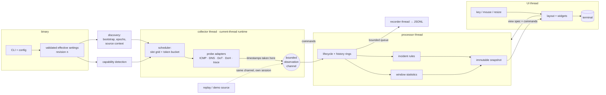

# 02 · Architecture decision

**Status:** draft for review · 2026-11-21 · planning only. Claim labels **[V] [R] [A] [T]** are defined in [01](01-design-spec.md). Versions and licences were read from package registries and project sources on 2026-11-21; sources are in [04 §1](04-references-and-open-questions.md#1-sources).

---

## 1. Decision

**Decided — Rust, confirmed by you on 2026-11-21.** Rust, with Ratatui 0.30 (Crossterm 0.29 backend) and Tokio 1.x, networking written directly on `socket2`/`libc`, `hickory-proto` as a DNS codec only, `tokio-rustls` and `hyper` for DoT and DoH.

**Credible alternative:** Go 1.27 with Bubble Tea v2, Lip Gloss v2, Bubbles v2, and ntcharts v2.

**Not recommended:** Python with Textual.

The Rust–Go margin is small and comes from judgement, not from benchmarks — none were run, and with four endpoints at 1 Hz performance is not a differentiator for any of the three. What decides it:

1. **Socket-level control is the core of this product.** Truthful ICMP outcomes on Linux need `IP_RECVERR` and the socket error queue; truthful TTLs need control messages. In Rust that is `socket2` plus a few `libc` calls inside one module. **[V]** that the maintained ping crates do not do this (§3.2).
2. **Timing boundaries stay ours.** Dialling a TCP socket, handing it to `tokio-rustls`, then to `hyper`'s connection-level HTTP/2 API gives separate connect, handshake, and request timings and exact knowledge of connection reuse. **[V]** (§3.4). Go gets the same for DoH from `net/http/httptrace` with less code — a real point for Go.
3. **Route tracing.** Rust can reuse its own ICMP engine for unprivileged traces on both systems and optionally adopt `trippy-core`, the engine of the tool you already use. Go has no clearly maintained traceroute library **[V]**.
4. **Deterministic tests.** Tokio's paused clock auto-advances timers on a current-thread runtime **[V]**, which is exactly the shape of the collector (§4).
5. **You stated a Rust preference and the toolchain is already installed** (`rustc` 1.100.0).

What would flip it to Go: dropping route inspection, or valuing time-to-first-release above socket-level control.

---

## 2. Stack comparison

### 2.1 Evidence, per stack

Everything in this table is **[V]** unless marked. "Expectation" rows are judgement.

| Topic | Rust · Ratatui · Crossterm · Tokio | Go · Bubble Tea v2 · Lip Gloss · Bubbles | Python · Textual · asyncio |
|---|---|---|---|
| Current releases | ratatui 0.30.2 (2026-06-19), crossterm 0.29.0 (2025-04-05), tokio 1.54.1 (2026-10-21) | bubbletea v2.1.2 (2026-11-18), lipgloss v2.1.1, bubbles v2.2.2, Go 1.27.4 | textual 8.2.8 (2026-06-30), Python ≥ 3.11 in practice |
| Version compatibility trap | Ratatui 0.30 selects Crossterm 0.29 by default (0.28 by feature flag); two Crossterm majors in one binary lose events and may not restore raw mode — use the `ratatui::crossterm` re-export and check `cargo tree -d` | v2 modules live at `charm.land/...`; v1 at `github.com/charmbracelet/...`; they do not mix. Bubbles v2 and ntcharts v2 both require Bubble Tea v2 + Lip Gloss v2 | dnspython 2.9 moved DoH from `httpx` to `httpx2`; `textual-plotext` pins `plotext < 6` |
| Line chart | built-in `Chart` with Braille/HalfBlock/Sextant/Octant markers and multiple datasets; **cannot break a line for missing data** (draws every consecutive pair); axis labels beyond three are mis-positioned | ntcharts v2 time-series chart with braille and named datasets; its README says the API "is still subject to change"; gap handling not verified | none built in; `textual-plot` 0.10.1 (single maintainer, needs numpy) or `textual-plotext` (no release since 2024-11) |
| Sparkline | built-in; supports absent values with their own symbol and style | ntcharts sparkline | built-in `Sparkline` |
| Table | built-in, stateful selection, manual widths | Bubbles `table` | built-in `DataTable` |
| Histogram / heatmap | none built in → custom widget writing `Buffer` cells | ntcharts has bar and heat-map charts | none built in |
| Animation | manual per-frame state (or `tachyonfx`, not needed) | manual per-frame state; default 60 fps cap | first-class `animate()` with easing |
| Colour downgrade | **not automatic**: Ratatui passes colours through; app must detect and map | automatic via `colorprofile`; honours `NO_COLOR`, `CLICOLOR_FORCE`, `COLORTERM` | automatic; `NO_COLOR` gives a monochrome filter |
| Keyboard / mouse / resize | Crossterm events: key, mouse (opt-in), resize, focus, paste; async `EventStream` | typed key/mouse messages, `WindowSizeMsg`, Kitty keyboard enhancements by default | bindings, mouse, `Resize` event |
| Alternate screen and cleanup | `ratatui::init()` enters raw mode + alt screen and installs a restoring panic hook; mouse capture and suspend are the app's job | declarative `View` fields; panics caught by default; `SuspendMsg`/`ResumeMsg`; synchronized output (mode 2026) on by default | managed by the framework; `App.suspend()` |
| Unprivileged ICMP | `socket2` DGRAM + ICMP protocol; hand-written engine | `x/net/icmp` `udp4`/`udp6` endpoints ("only Darwin and Linux"); `pro-bing` wraps it | `icmplib` `privileged=False`; no release since 2023-10, LGPLv3 |
| ICMP errors on Linux unprivileged sockets | reachable via `libc` (`IP_RECVERR`, `MSG_ERRQUEUE`) | reachable via `x/sys/unix`; not provided by `pro-bing` (not verified either way) | reachable via `socket` module constants; not provided by `icmplib` |
| DNS wire codec | `hickory-proto` 0.26.3, now codec-only by design | `miekg/dns` v1 (fixes only, to be archived) or v2 on Codeberg (pre-1.0, breaking changes expected) | `dnspython` 2.9.2 |
| DoH/DoT phase timing | own dial → `tokio-rustls` → `hyper` conn API: connect, handshake, request, reuse all visible | `httptrace.ClientTrace` exposes connect, TLS, `GotConn{Reused}`, first byte; DoT via own dial | `dnspython` exposes one total (`response.time`, from the wall clock); phases need own sockets |
| Timers | `MissedTickBehavior` Burst (default) / Delay / Skip, explicit | `time.Ticker` "will adjust the time interval or drop ticks to make up for slow receivers" | `call_later` on a monotonic clock; any 1 s CPU-bound callback delays every task 1 s |
| Fake clock for tests | `tokio::time::pause()` with auto-advance, current-thread runtime | `testing/synctest` (GA since Go 1.25); network I/O must be faked | no standard equivalent; `Pilot` for UI |
| UI tests | `TestBackend` + `insta` snapshots (text only; styles asserted on cells); PTY crates exist | `teatest/v2` — experimental, untagged; golden files | `pytest-textual-snapshot` (SVG), `Pilot` |
| Route tracing library | `trippy-core` 0.13.0 (API "not stable"; threads; Linux needs `CAP_NET_RAW`) or own ICMP engine | no clearly maintained library found | `icmplib.traceroute` "should always be run as root" |
| Packaging | one binary per target; rustls' default crypto needs a C compiler at build; musl targets are Tier 2 | one static binary with `CGO_ENABLED=0`; cross-compiles from one host; GoReleaser | needs a Python runtime (`uv tool install`/`pipx`) or a bundler: PyInstaller is not a cross-compiler and unpacks to a temp dir each start |
| Licences | MIT / Apache-2.0 / ISC family throughout | MIT / BSD-3-Clause; `pro-bing` is MIT at its last tag and Apache-2.0 on main | MIT / ISC / BSD, but `icmplib` LGPLv3; PyInstaller GPL with exception; Nuitka AGPL with exception |
| Ecosystem health | Ratatui: 23k stars, four maintainers, no 1.0 plan, breaking 0.31 queued; Crossterm: no release in 19 months, repo active | Bubble Tea: 46k stars, 14 releases in 12 months; ntcharts: 816 stars | Textual: 38k stars, 30 releases to June 2026, **none since**; maintainer says responses may be slow |
| Accessibility | nothing official (screen readers, reduced motion); a11y discussion open, nothing implemented | `NO_COLOR` handled; nothing found on screen readers | monochrome mode done; screen-reader integration unchecked on the roadmap |

Expectations (not evidence): all three can render 15 fps for a 160 × 45 dashboard and send ten packets a second with negligible CPU **[A]**. A garbage collector or interpreter does not disqualify Go or Python here; what counts against Python is that probe timestamps, DNS parsing, and UI rendering would share one interpreter lock and, by default, one event loop.

### 2.2 Weighted decision matrix

Scores are 1–5 and are **judgement** based on §2.1. Weights sum to 100.

| Criterion | Weight | Why this weight | Rust | Go | Python |
|---|---:|---|---:|---:|---:|
| Measurement correctness and control (sockets, error queue, timing boundaries, timers, cancellation) | 25 | The product is an instrument first; a wrong number is the worst failure | 5 | 4 | 2 |
| Visual capability (charts with gaps, sparklines, custom cells, histogram, timeline, motion) | 20 | Stated as an equal priority | 4 | 4 | 3 |
| Terminal interaction and robustness (input, resize, alt screen, cleanup, colour handling) | 10 | Long sessions must never leave a broken terminal | 4 | 5 | 4 |
| Platform and probe coverage (macOS/Linux, v4/v6, unprivileged operation, route tracing) | 10 | Unprivileged by default on both systems is a hard requirement | 4 | 3 | 2 |
| Testing, determinism, replay | 10 | Acceptance criteria depend on fake clocks and scripted outcomes | 5 | 4 | 3 |
| Packaging and distribution | 8 | A single artefact per platform matters for a tool you will install on several machines | 4 | 5 | 2 |
| Ecosystem health and licensing | 7 | A multi-year tool should not sit on stale dependencies | 4 | 4 | 2 |
| Development effort to first useful release | 5 | Matters, but less than getting the numbers right | 3 | 4 | 4 |
| Long-term complexity and maintainability | 5 | Small codebase, one owner | 4 | 4 | 3 |
| **Weighted total (max 500)** | 100 | | **430** | **408** | **265** |

Why each stack lost points:

- **Rust 4 on visuals:** `Chart` cannot draw gapped lines and there is no histogram or heatmap widget, so the comparison chart, timeline, and histogram are custom widgets. That is a cost, not a blocker — cell-level `Buffer` access makes them straightforward.
- **Rust 4 on terminal robustness:** colour downgrade, mouse capture, and suspend handling are application code; Crossterm's `NO_COLOR` handling may also strip bold and reverse (source reading, **[T]**), so the application will own monochrome itself.
- **Rust 3 on effort:** the ICMP engine and the DoT/DoH clients are hand-written.
- **Go 4 on measurement:** equal access to the OS, slightly less direct for control messages; `httptrace` is a genuine advantage for DoH. **Go 3 on coverage:** route tracing would be hand-written or a subprocess.
- **Python 2 on measurement:** the convenient libraries hide the phases this product must expose, and timing shares an interpreter with rendering. **Python 2 on packaging and ecosystem:** runtime dependency, a stale and LGPL ICMP library, and a UI framework with no release in five months.

Sensitivity: the 22-point lead is not robust. Moving 10 points of weight from "measurement" to "effort" gives Rust 410 and Go 408 — a tie. Scoring Rust and Go equally on "coverage" (no route tracing) narrows it to 12. No reasonable reweighting brings Python within 100 of either.

---

## 3. Dependencies and backends

### 3.1 Candidate dependency set

Kept deliberately small. Versions are the current releases **[V]**; exact pins are made by the lockfile at scaffold time. The minimum supported Rust version is driven by `ratatui` and `hickory-proto` at **1.88** **[V]**.

| Crate | Version | Licence | Responsibility in this application | Constraint to respect |
|---|---|---|---|---|
| `tokio` | 1.54.1 | MIT | runtimes, timers, `AsyncFd`, channels (`mpsc`, `watch`), signals | never use the default `Burst` tick behaviour; 1.53.x is an LTS line if a slower-moving base is wanted |
| `tokio-util` | 0.7.20 | MIT | `CancellationToken` tree for shutdown | — |
| `socket2` (feature `all`) | 0.6.5 | MIT OR Apache-2.0 | create ICMP datagram, UDP, and TCP sockets; TTL; interface and source binding | has no setter for `IP_RECVERR` or IPv4 `IP_RECVTTL` → those go through `libc` |
| `libc` | pin at scaffold | MIT OR Apache-2.0 | the handful of calls `socket2` lacks: `IP_RECVERR`, `MSG_ERRQUEUE`, control-message parsing, suspend-aware clocks | confined to one `platform` module; every `unsafe` block reviewed and tested |
| `hickory-proto` | 0.26.3 | MIT OR Apache-2.0 | DNS message build and parse only (`Message`, `Query`, `Edns`, `ResponseCode`) | codec only — no hickory transport, client, or resolver on the measurement path; 0.26 changed the `Message` API from 0.25, so follow current docs, not older examples |
| `rustls` + `tokio-rustls` | 0.23.46 / 0.26.6 | Apache-2.0 OR ISC OR MIT / MIT OR Apache-2.0 | TLS for DoT and DoH over a socket we dialled ourselves; server name supplied separately from the address | default provider `aws-lc-rs` needs a C compiler at build time (no CMake for non-FIPS builds) |
| `rustls-platform-verifier` | 0.7.1 | MIT OR Apache-2.0 | certificate verification against the OS trust store | macOS path can check revocation, which may add time inside the handshake measurement **[T]** |
| `hyper` + `hyper-util` (+ `http-body-util`) | 1.12.0 / 0.1.21 | MIT | HTTP/2 for DoH through the connection-level API (`client::conn::http2`) | we own connection lifecycle; no pooling layer |
| `netdev` | 0.47.0 | MIT | default interface and default gateway snapshot | snapshot only |
| `netwatcher` | 0.8.0 | MIT | interface change events that trigger a re-snapshot | young crate; wrap behind a trait; fall back to periodic re-snapshot **[T]** |
| `ratatui` | 0.30.2 | MIT | layout, buffer, built-in widgets (`Block`, `Table`, `Tabs`, `Paragraph`, `Sparkline`, `Scrollbar`) | 0.x: expect breaking changes at 0.31; custom widgets for chart, timeline, histogram |
| `crossterm` (feature `event-stream`) | 0.29.0 | MIT | async terminal events; same major as Ratatui's backend | exactly one Crossterm major in the tree |
| `clap` (feature `derive`) | 4.6.9 | MIT OR Apache-2.0 | command-line parsing; usage errors exit 2 | — |
| `serde`, `toml`, `serde_json` | 1.0.229 / 1.2.2 / 1.0.154 | MIT OR Apache-2.0 | configuration and JSONL | `deny_unknown_fields` on config types |
| `thiserror` | 2.0.21 | MIT OR Apache-2.0 | typed errors in the core | — |
| `tracing`, `tracing-subscriber`, `tracing-appender` | 0.1.44 / 0.3.23 / 0.2.5 | MIT | file logging off the screen | the non-blocking appender is lossy by default and needs its guard held |
| `jiff` | 1.0.1 | Unlicense OR MIT | UTC wall-clock timestamps, RFC 3339 | 1.0 is days old; `time` 0.3.55 is the conservative substitute |
| `etcetera` | 0.11.0 | MIT OR Apache-2.0 | XDG paths on macOS as well as Linux | — |
| `anstyle-query` | 1.1.5 | MIT OR Apache-2.0 | read `NO_COLOR`, `CLICOLOR_FORCE`, `COLORTERM`, `TERM` | detection primitives only; the palette mapping is ours |
| `unicode-width` | 0.2.3 | MIT OR Apache-2.0 | cell widths in custom widgets | same version Ratatui uses |
| `signal-hook` | 0.4.6 | MIT OR Apache-2.0 | raise `SIGTSTP` for suspend | Crossterm already depends on a `signal-hook`; confirm one version in the tree **[T]** |
| *dev:* `insta` | 1.49.0 | Apache-2.0 | snapshot tests | captures text, not styles |
| *dev:* `termlens` (or `portable-pty` + `vt100`) | 0.11.10 | MIT OR Apache-2.0 | pseudo-terminal end-to-end tests | young crate; the pair it is built on is the fallback |
| ~~*optional:* `trippy-core`~~ | 0.13.0 | Apache-2.0 | **not adopted** — evaluated and dropped, 2026-11-21 | see §3.3 and [milestone-3-status.md](milestone-3-status.md) |
| *macOS / Linux resolver discovery:* `system-configuration`, `resolv-conf` | 0.8.0 / 0.7.6 | MIT OR Apache-2.0 | read the system's configured resolvers for the local-DNS control (milestone 3) | under systemd-resolved the file lists only `127.0.0.53` |

Deliberately **not** used: `surge-ping` (§3.2), `reqwest` (cannot separate connect, TLS, and request, or report reuse **[V]**), `hickory-net`/`hickory-resolver` on the measurement path (no phase timing or peer address **[V]**), `hdrhistogram` (exact percentiles from raw samples are simpler and sufficient), `tachyonfx`, `color-eyre`, `pnet`.

Licence posture: everything above is permissive. A licence and advisory check (`cargo deny`) runs in CI from milestone 1. The project's own licence is an open question.

### 3.2 ICMP: library or hand-written

| Requirement ([01 §4](01-design-spec.md#4-measurement-semantics)) | `surge-ping` 0.9.1 **[V]** | Hand-written on `socket2` + `AsyncFd` + `libc` |
|---|---|---|
| Unprivileged datagram sockets, IPv4 + IPv6 | yes (tries datagram, falls back to raw) | yes |
| Send timestamp immediately **before** the send call | no — taken after the send call returns | yes |
| Match on payload, not only id/sequence | no | yes |
| Report duplicates | no — later replies are discarded | yes |
| Distinguish timeout from ICMP unreachable on Linux unprivileged sockets | no — no error-queue handling, so errors surface as timeouts | yes (`IP_RECVERR` + `MSG_ERRQUEUE`) |
| TTL of the reply on Linux unprivileged sockets | no | yes (`IP_RECVTTL` control message) |
| Late replies annotated on finalised probes | no | yes |
| One shared socket and receiver per family | yes | yes |

**Decision [R]:** hand-written ICMP engine, roughly 600–900 lines including tests, isolated in `probe::icmp` and `platform::{linux,macos}`. The two systems deliver different shapes, and the engine handles both explicitly **[V]**:

| | Linux datagram ICMP | macOS datagram ICMP |
|---|---|---|
| Identifier | rewritten by the kernel to the socket's port; replies demultiplexed to the socket by it | preserved; **not** used by the kernel for filtering |
| What `recv` returns | Echo Reply only, ICMP header onward, no IP header | every inbound ICMP message of the family, for all processes, with the IPv4 header |
| ICMP errors | only via the error queue when `IP_RECVERR` is set | delivered on the same socket if it is unconnected |
| Consequence | read TTL from control messages; poll the error queue | parse the IP header; filter strictly by source, magic, nonce, and sequence; count the rest as `unmatched` |

`surge-ping` remains the fallback if the hand-written engine proves troublesome on a platform; adopting it would mean accepting the gaps in the left column and documenting them.

### 3.3 Route tracing backend

| Option | Unprivileged? | Fit | Cost |
|---|---|---|---|
| **A. Own ICMP tracer on the milestone-1 engine** — set TTL on a dedicated trace socket, read Time Exceeded from the same socket (macOS) or the error queue (Linux) | macOS: yes. Linux: yes where `ping_group_range` allows. **[V]** that both kernels permit this | same timestamps, cancellation, budget enforcement, and observation schema as everything else; ICMP only, classic strategy only | a few hundred lines on top of existing code; matching Time Exceeded uses the quoted header (identifier + 16-bit sequence), not the payload |
| **B. `trippy-core` 0.13.0 adapter** | macOS: yes. **Linux: no — needs `CAP_NET_RAW`, root, or setuid** **[V]** | ICMP/UDP/TCP, Paris and Dublin strategies when privileged, per-probe results via `Round`/`ProbeStatus`, `max_rounds` | API explicitly "not stable"; last release 2025-05; synchronous, runs on its own thread; **no stop API in 0.13.0** (bounded only by `max_rounds`); probe timestamps are wall-clock `SystemTime`; unreleased master has moved to a newer compiler floor |
| **C. Subprocess** (`trip --mode json`, `mtr --json`) | as B for `trip`; `mtr` varies by build | none of our schema or timing | `trip`'s JSON has no documented schema stability; `mtr` JSON needs a build-time library; `ping` has no machine-readable output on macOS and only an experimental unreleased flag in iputils **[V]** |

**Decision [R]:** A is the default backend in milestone 3. B is an optional, feature-gated adapter evaluated in a time-boxed spike at the start of milestone 3; it earns its place only if UDP/TCP or Paris-style tracing turns out to matter to you. If adopted, its limits are shown in the UI: the trace is labelled with backend and version, RTTs are marked as wall-clock-derived, and a running trace is bounded by rounds rather than cancellable.

**Outcome (2026-11-21):** B was evaluated in milestone 3 (task 3.3) and dropped: it has no way to stop a running trace, does not pace its probes, and on Linux traces nothing without `CAP_NET_RAW`. A is the only backend. Details: [milestone-3-status.md](milestone-3-status.md).

C is not planned. Should a subprocess ever be justified, the rules are fixed now: documented machine-readable output only (never scraping a terminal UI); arguments passed as an array, never through a shell; `LC_ALL=C`; the tool's path and version captured once and shown in the Capabilities screen; output read through a bounded buffer with a line-length limit; a hard wall-clock limit and kill on cancel; one process per trace, never one per sample; and process run time is never reported as network RTT.

### 3.4 What each layer can and cannot time

| Layer | Start → end points we control | Not separable with the chosen libraries |
|---|---|---|
| ICMP echo, DNS/UDP | user-space timestamp before `send` → after `recv` | kernel queueing, NIC time, receive-side scheduling delay (flagged by the loop-lag monitor, not removed) |
| TCP connect | connect future started → socket writable | SYN retransmissions (a ~1 s connect is probably a retransmit, but that is inference) |
| TLS handshake | `TlsConnector::connect` started → resolved | network round trips vs server compute vs **local certificate verification**, which runs inside the handshake |
| DoT query (reused) | first byte of length-prefixed query written → last byte of response read | server processing vs network |
| DoH request (reused) | request future started → response headers (`ttfb`) → body complete | HTTP/2 frame scheduling; server processing vs network |
| HTTP/2 connection setup | client preface written | the server's SETTINGS exchange is not a clean phase; the first request on a fresh connection absorbs it and is tagged `fresh` |
| Connection facts | reuse, age, ALPN, TLS version, full vs resumed handshake, peer address | — (we own the connection objects) |
| Bootstrap resolution via the OS | call start → return, recorded as a duration only | which upstream answered, TTLs, cache hits — hence the explicit-resolver option |

---

## 4. Concurrency model

### 4.1 Modules and data flow

Proposed layout (nothing has been created):

```text
crates/
  pathwatch-core/   no terminal dependencies
    config/         parse, validate, effective settings with provenance, revisions
    model/          ids, Observation, Event, Gap, outcome enums, schema version
    capability/     host probing: which sockets, options, and clocks work here
    discovery/      bootstrap resolution, destination epochs, source context, network-change watch
    schedule/       slot grid, phase stagger, global token bucket
    probe/          icmp, dns_udp, dns_tcp, dot, doh, trace   (adapters behind one trait)
    platform/       linux.rs, macos.rs   (all libc and unsafe lives here)
    engine/         observation processor: lifecycle state machine, history, statistics, incidents
    snapshot/       immutable view models
    record/, replay/, redact/, sanitize/
  pathwatch-tui/    depends on pathwatch-core::snapshot only: layouts, widgets, input, theme
  pathwatch/        binary: CLI, wiring, signals, exit codes
```

The compiler enforces the main boundary: `pathwatch-core` cannot depend on Ratatui, so the renderer cannot own probe timing, and `pathwatch-tui` sees only snapshot types, so it cannot do network work.



### 4.2 Threads and tasks

| Thread | Runs | Why separate |
|---|---|---|
| **Collector** | a current-thread Tokio runtime: scheduler, all sockets, receive loops, deadlines, loop-lag heartbeat | nothing here ever blocks on the terminal or on statistics, so receive timestamps are taken promptly; it is also the same runtime flavour the paused-clock tests require |
| **Processor** | observation lifecycle, history, statistics, incidents, snapshot building | a 24-hour percentile recomputation must not delay a receive timestamp |
| **UI** (main thread) | terminal events via `EventStream`, layout, drawing | a slow terminal or SSH link can block a write; that must stall only drawing |
| **Recorder** | JSONL serialisation and file I/O | disk latency stays off every other path |
| Blocking pool | OS resolver calls for bootstrap, reverse DNS for traces, the optional `trippy-core` thread | synchronous APIs |

Each provider stream is its own task on the collector. A slow or dead target occupies only its own pending entries; it cannot delay another stream's send, and no stream waits on another's reply.

### 4.3 Scheduling

- **Slot grid.** Stream *i* sends at `t0 + phase_i + k × interval`. Phases spread streams of the same interval evenly (nine 1 Hz ICMP streams are ~111 ms apart; nine 5 s DNS streams ~555 ms apart) in configuration order, so runs are reproducible and there are no synchronised bursts.
- **Missed ticks.** The scheduler sleeps until the next slot deadline and, on waking, computes which slot index "now" belongs to. Slots that were passed over are recorded explicitly as `skipped(late_timer)` — or folded into a gap if the lateness crosses the gap threshold ([01 §4.5](01-design-spec.md#45-observation-gaps)). This is the behaviour Tokio documents for `MissedTickBehavior::Skip` ("Skips missed ticks and tick on the next multiple of `period` from `start`") **[V]**, with the added accounting that `Interval` does not provide.
- **Why not the alternatives [V]:** `Burst` — the default for `tokio::time::interval` — "ticks as fast as possible until caught up", which is exactly the catch-up probe burst this design forbids. `Delay` re-bases the schedule on the late tick, so the phase stagger would drift and streams could align.
- Any `tokio::time::interval` used elsewhere (render tick, heartbeat) sets `Skip` explicitly.
- **After suspend.** Tokio timers follow a clock that does not advance during system sleep on macOS or Linux **[V]**, so no timer backlog exists on resume; the gap detector supplies the missing knowledge that time passed.
- **Global limits.** A token bucket (25 per second, burst 40) and an in-flight cap (128) sit in front of every send. A refused slot is `skipped(rate_limit)`.
- **No overlap.** A stream never has two transactions on a connection-oriented transport at once; a slot arriving while one is in flight is `skipped(in_flight)`. ICMP may have several probes pending because its deadline (2 s) exceeds its interval (1 s).
- **Deadlines** are absolute monotonic instants stored with each pending probe and enforced by one deadline queue per runtime, not one timer per probe.

### 4.4 History and memory bounds

| Store | Per stream | Bound | Approximate size |
|---|---|---|---|
| Compact sample ring | slot-indexed: RTT (µs, 32-bit, with a "none" value), outcome, flags — 6 bytes per slot | 24 h | 518 kB per 1 Hz stream; 104 kB per 5 s stream |
| Full observation ring | every schema field | 1 h | ≈ 0.6 MB per ICMP stream, ≈ 0.2 MB per DNS stream |
| Event ring | all streams | 10,000 events | ≈ 2 MB |
| Trace results | one active trace + the last one per provider | ≤ 300 probes each | negligible |

All rings are allocated at stream creation, so memory does not grow during a session. With ~26 streams the history totals roughly 17 MB **[A]**; the resident-memory budget is in [03 §5](03-implementation-plan.md#5-performance-budgets).

Statistics for a window are computed by copying that window's eligible samples into a scratch buffer and selecting the needed ranks. They are recomputed when new observations arrive, at most once per snapshot, and cached per (stream, window).

### 4.5 Channels, backpressure, and overload

| Channel | Type and capacity | Producer behaviour when full | What the user sees |
|---|---|---|---|
| Observations: collector → processor | bounded `mpsc`, 4096 | the collector **reserves capacity for a probe's events before sending the probe**; if it cannot, the slot becomes `skipped(backpressure)`. A probe that was sent can therefore always report its result | `collector backpressure` counter and header notice — separate from every network rate |
| Snapshot: processor → UI | `watch` (retains only the latest value) | overwrite | nothing; stale frames are simply never drawn |
| View spec and commands: UI → processor → collector | bounded `mpsc`, 64 | `try_send`; on failure the key press is rejected with a visible "busy" | footer message |
| Recorder: processor → recorder | bounded `mpsc`, 8192 | `try_send`; on failure the record is dropped, a counter increments, and a `recorder_gap` record with the drop count is written when space returns | event + header notice; measurement unaffected |
| Trace results | bounded `mpsc`, 1024 | reserve-before-send, as for observations | — |
| Reverse-DNS requests | bounded, 64 | drop oldest (enrichment only), counted | name stays `—` |

**Order of sacrifice under load:** (1) render frames — coalesced by construction, then the frame rate falls to the idle rate; (2) enrichment; (3) snapshot rate; (4) recording, with counted gaps; (5) measurement slots, as explicit `skipped` records. Nothing is discarded silently, and a collector drop can never be mistaken for network loss because it never enters a network denominator.

**Rendering cadence.** The UI redraws when the snapshot changes, on input, on resize, and at up to 15 fps while an animation from [01 §9.8](01-design-spec.md#98-motion) is in progress. Otherwise it sleeps. Collection cadence does not depend on any of this: a snapshot is a pure function of (history, view spec, as-of time), so the same observations give the same statistics at any frame rate — an acceptance test asserts it.

### 4.6 Cancellation, shutdown, and errors

- One root `CancellationToken`; child tokens per stream, per connection, per trace. Reconfiguring a stream cancels only its subtree.
- **Shutdown order:** restore the terminal → stop scheduling → finalise pending probes as `cancelled` → close sockets → drain the observation channel → flush and close the recording → exit. A 3-second overall limit, then exit regardless.
- **Terminal restoration** happens first on every exit path — normal quit, signal, fatal error, panic on any thread (the panic hook restores before printing) — and covers raw mode, alternate screen, cursor visibility, and mouse capture.
- **Error classes.** A failing probe is data: an observation or an event. A failing stream (socket cannot be created, option refused) is a stream state. Only failures of the instrument itself — a thread panic, an unrecoverable terminal error — end the process, with exit code 1 after restoration.

---

## 5. Platform capability matrix

What the operating system permits **[V]**, kept separate from what a library implements. "Planned" is this application's own code and is **[T]** until milestone 1's integration tests pass on real hosts.

| Capability | Linux — OS | macOS — OS | Planned (own code) | `trippy-core` 0.13.0 | `surge-ping` 0.9.1 |
|---|---|---|---|---|---|
| Unprivileged ICMPv4 echo | allowed if the process's group is within `net.ipv4.ping_group_range`; kernel default is off (`1 0`); kernel ≥ 3.0 | allowed by default (datagram ICMP socket) | yes | macOS only | yes |
| Unprivileged ICMPv6 echo | same sysctl governs it; kernel ≥ 3.11 | allowed by default | yes | macOS only | yes |
| Raw ICMP | needs `CAP_NET_RAW` in the owning user namespace, or root | needs root | not used by default; `backend = "raw"` exists but is never requested or escalated automatically | yes (its normal mode) | fallback |
| ICMP errors visible on the unprivileged socket | yes, via `IP_RECVERR` and the error queue | yes, on an unconnected socket | yes | n/a | **no** on Linux |
| Reply TTL on the unprivileged socket | yes, via `IP_RECVTTL` control message | yes, from the delivered IP header | yes | n/a | no on Linux |
| Unprivileged route trace, ICMP probes | yes where ping sockets are enabled (`IP_TTL` + error queue) | yes (`IP_TTL`; Time Exceeded arrives on the socket) | yes — milestone 3, option A | macOS only | — |
| Unprivileged route trace, UDP probes | yes by default (UDP socket + error queue) | yes (errors read from a datagram ICMP socket) | not planned | macOS only | — |
| Flow-controlled traces (Paris/Dublin), TCP SYN | needs `CAP_NET_RAW` or root | needs root | not planned | privileged only | — |
| Bind to a source address | unprivileged `bind()` to a local address | unprivileged `bind()` | yes | yes | yes |
| Bind to an interface | `SO_BINDTODEVICE`: unprivileged on kernel ≥ 5.7 for a socket not already bound; `CAP_NET_RAW` before that or to change a binding | `IP_BOUND_IF` / `IPV6_BOUND_IF`, no privilege check | yes; refusal → `UNSUPPORTED (binding)`, no silent fallback | yes | yes |
| Kernel receive timestamps | available on ping sockets (`SO_TIMESTAMPNS`, realtime clock) | available (`SO_TIMESTAMP_MONOTONIC`, same clock as our timers) | **in use since 2026-11-21** for ICMP: the round trip ends at the kernel stamp ([01 §4.1](01-design-spec.md#41-clocks-and-timestamp-points)); verified on both systems | no | no |
| Suspend-aware clock pair | `CLOCK_MONOTONIC` (excludes suspend) vs `CLOCK_BOOTTIME` (includes) | `CLOCK_UPTIME_RAW` (excludes) vs `CLOCK_MONOTONIC_RAW` (includes) | yes, for gap detection | — | — |
| DNS over UDP/TCP/TLS/HTTPS | no privilege | no privilege | yes | — | — |

**Where Linux unprivileged ICMP is on by default [V]:** distributions shipping systemd's default sysctl file (systemd ≥ 243) — Fedora 31+, Arch, and Debian 13 through its `linux-sysctl-defaults` package; Docker ≥ 20.10 containers. **Not** set by Ubuntu according to its bug tracker, which restored a capability on `ping` instead. Other hosts vary.

**What the application does about it.** `pathwatch doctor` reports, per family: whether the datagram ICMP socket could be created, the current `ping_group_range`, your group ids, kernel version, whether interface binding was accepted, which clock pair is available, and which backend each probe type will use. Where something is unavailable it prints the remedy documented by the OS — for example the sysctl line — for you to apply or not. It never applies it. ICMP cards then show `UNSUPPORTED (unprivileged ICMP disabled on this host)` and DNS measurement proceeds.

**Your Linux hosts (Ubuntu and Debian).** On Ubuntu, expect unprivileged ICMP to be off until you enable it; on Debian 13 expect it on; Debian 12 was not confirmed, so `doctor` decides. The remedy `doctor` prints is the one-line sysctl that systemd's defaults use, `net.ipv4.ping_group_range = 0 2147483647`, placed in a file under `/etc/sysctl.d/`. Inside a container whose group-id mapping is narrower than that range the kernel rejects it — the reason Ubuntu gave for not shipping it — and a range covering just your own group id is the alternative. Applying either is your action; DNS, DoH, and DoT measurement need none of it. **[T]** on your actual releases.

Privilege escalation is never part of normal operation. If you choose to grant a file capability for a raw backend, the documented caveats apply **[V]**: it is ignored on `nosuid` mounts and under `no_new_privs`, it must be reapplied after the binary is replaced, and the dynamic loader then ignores `LD_LIBRARY_PATH`.

---

## 6. Observation schema

Logical schema, version 1. One record per finalised probe attempt. Field names are those used in JSONL.

| Group | Fields |
|---|---|
| Envelope | `schema` (integer), `kind` (`observation`), `session` (id), `config_rev` |
| Identity | `provider`, `target` (configured id), `stream` (stable id of target + protocol + family + scenario), `seq` (64-bit), `transaction` (links attempts and fallbacks), `attempt` |
| Measurement | `protocol` (`icmp`, `dns-udp`, `dns-tcp`, `dot`, `doh`, `trace`), `family` (`4`, `6`), `configured` (address, hostname, or URL as written; redactable), `dest_ip`, `dest_port`, `epoch` |
| Source context | `src.ctx` (id of a separately recorded context), `src.if`, `src.ifindex`, `src.ip` |
| Time | `sched_ns`, `sent_ns`, `recv_ns` (monotonic nanoseconds since session start — comparable only within a session), `sent_utc` (RFC 3339), `deadline_ms`, `sched_lag_us` |
| Result | `outcome` ([01 §4.3](01-design-spec.md#43-probe-outcomes)), `error.category`, `error.code`, `error.detail` (sanitised), `rtt_us` (absent when there is none — never 0, never the deadline), `late_rtt_us`, `flags` (`late`, `duplicate`, `timing_suspect`, `after_reconnect`, `truncated`, `fresh`) |
| Phases | `phase.connect_us`, `phase.tls_us`, `phase.request_us`, `phase.ttfb_us` — present only for the phases that occurred |
| ICMP | `icmp.id`, `icmp.seq16`, `icmp.reply_ttl`, `icmp.type`, `icmp.code`, `icmp.payload` (bytes) |
| DNS | `dns.qname`, `dns.qtype`, `dns.id`, `dns.rcode`, `dns.tc`, `dns.answers`, `dns.size`, `dns.min_ttl`, `dns.ede[]`, `dns.expect`, `dns.matched` |
| Connection | `conn.id`, `conn.reused`, `conn.age_ms`, `conn.alpn`, `conn.tls`, `conn.resumed`, `conn.sni` (redactable), `conn.http_status` |
| Backend | `backend.name`, `backend.version`, `backend.ts_source` (`userspace-monotonic`, later others) |

Other record kinds share the envelope: `session` (start/stop, versions, host), `config` (redacted effective settings per revision), `source_context`, `resolution` (bootstrap result), `connection` (open/close with phase timings and reason), `event`, `incident`, `gap`, `trace_probe`, `recorder_gap`.

An illustrative record (wrapped here; one line on disk):

```json
{"schema":1,"kind":"observation","session":"01JD…","config_rev":1,"provider":"cloudflare",
 "target":"resolver-v4","stream":"cloudflare/resolver-v4/icmp/4","seq":6141,"protocol":"icmp",
 "family":"4","configured":"1.1.1.1","dest_ip":"1.1.1.1","epoch":1,
 "src":{"ctx":2,"if":"en0","ifindex":11,"ip":"192.0.2.10"},
 "sched_ns":6141000000000,"sent_ns":6141000212000,"recv_ns":6141012611000,
 "sent_utc":"2026-11-21T14:03:21.412Z","deadline_ms":2000,"sched_lag_us":212,
 "outcome":"success","rtt_us":12399,"flags":[],
 "icmp":{"id":41822,"seq16":6141,"reply_ttl":57,"type":0,"code":0,"payload":56},
 "backend":{"name":"icmp-dgram","version":"0.1.0","ts_source":"userspace-monotonic"}}
```

---

## 7. Persistence, recording, and replay

**In memory by default.** Nothing is written to disk unless recording is enabled.

**JSONL before a database [R].** A recording is an append-only stream of the records in §6, which is what JSONL is. It needs no migration machinery, survives a crash with at most one truncated last line, streams naturally into replay, and works with `jq`, `grep`, and `tail -f`. A database would add a dependency and a schema-migration burden to answer queries nobody has asked for yet. It is deferred until long-range querying is a demonstrated need.

| Topic | Design |
|---|---|
| Layout | `<directory>/<session-id>/000001.jsonl`, `000002.jsonl`, … |
| Segment header | first line of every segment: schema version, application version and backends, host OS/arch, redacted effective configuration, session id, segment number. Each segment is self-describing |
| Rotation | at 64 MiB or 24 h, whichever comes first |
| Retention | total size cap (default 1 GiB); oldest segments deleted first, never the one being written |
| Volume | on the order of 0.3–0.5 GB per day uncompressed with every stream enabled **[A]** (≈ 1.2 million records at a few hundred bytes); compression of closed segments is a later option |
| Durability | flush per batch; `fsync` on rotation by default (configurable) |
| Schema versioning | integer `schema`; readers accept the versions they know, ignore unknown fields, and preserve unknown enum values as text; a breaking change increments the number and ships a converter in `export` |
| Disk full / write error | recording stops and the segment is closed if possible; an event and a persistent header notice appear; **measurement continues**; recording resumes only on your action |
| Low disk | recording stops before the disk fills, at the configured free-space floor |
| Recovery | a truncated final line is skipped with a warning on replay or export; all complete lines are used |
| Redaction | **as built (2026-11-21): applied at write time for recordings too**, so a profile id is never on disk — see [milestone-3-status.md](milestone-3-status.md). Originally: applied at write time for logs and at export time for recordings (default on): NextDNS profile IDs in URLs, server names, and configuration; optionally local addresses and hostnames. A recording made without redaction says so in its header |

**Replay and demo.** A `ReplaySource` and the built-in demo scenarios implement the same interface as the live collector and feed the same processor through the same channel, driven by a virtual clock. They run under their own session id with their own incident state, cannot write into a live recording, and keep `REPLAY` or `DEMO` in the header for the whole session. Because statistics are a pure function of observations, replaying a recording reproduces the statistics the live session showed — an acceptance test asserts this.

---

## 8. Trade-offs accepted

| Choice | Cost | Mitigation |
|---|---|---|
| Hand-written ICMP engine | `unsafe` control-message code; two receive shapes | one small module, fixtures of real packet bytes, integration tests on both systems; `surge-ping` as the fallback |
| Pre-1.0 UI stack | Ratatui 0.31 is queued with breaking changes; Crossterm has a breaking release pending | lockfile pins; widgets and backend behind thin internal interfaces; upgrade as its own task |
| Custom chart, timeline, histogram widgets | more UI code than using `Chart` | needed anyway for gaps, min–max columns, and the cursor; unit-tested against `Buffer` |
| Own colour downgrade and monochrome | a mapping table to maintain | small, and it makes identity colours deliberate at every depth |
| Three threads plus a recorder | more moving parts than a single loop | each boundary is a single channel with a stated full-queue behaviour |
| `aws-lc-rs` as the TLS crypto provider | a C compiler at build time | acceptable for release builds; `ring` remains an opt-in alternative |
| `trippy-core` not adopted (decided 2026-11-21) | no UDP/TCP/Paris traces | the milestone-3 evaluation: no way to stop a trace or pace its probes, and no unprivileged tracing on Linux |
| JSONL, not a database | large files, no indexed queries | rotation and caps now; revisit with evidence |

**If Rust is rejected**, the Go design keeps this document's sections 4–7 almost unchanged: goroutines for streams, a collector goroutine pinned to its own OS thread, `x/net/icmp` plus `x/sys/unix` for the error queue, `miekg/dns` as codec (v1 while it is still maintained), `httptrace` for DoH phases, ntcharts or a custom cell canvas for the chart, `testing/synctest` with a fake network for determinism, and an own ICMP tracer since no library fills that role.
